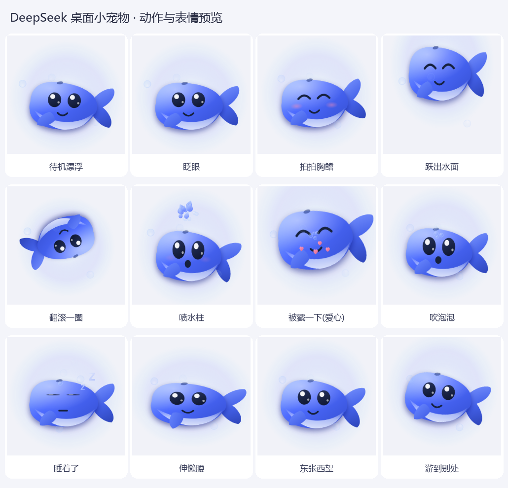

# DeepSeek 桌面小宠物 🐋

一只 DeepSeek 蓝鲸小精灵,常驻在桌面角落:会漂浮摆尾、会喷水柱、会吹泡泡,戳一下还会翻个身给你看。

**零依赖**:只用 Windows 自带的 WPF + PowerShell,不用装 Python / Node / 任何运行库。



---

## 快速开始

| 方式 | 操作 |
| --- | --- |
| 推荐 | 双击 **`启动宠物.vbs`**(无黑框,启动后直接出现) |
| 备用 | 双击 **`启动宠物.bat`**(若 .vbs 被杀软/策略拦截) |
| 命令行 | `powershell -NoProfile -ExecutionPolicy Bypass -File DeepSeekPet.ps1` |
| 退出 | 右键点小鲸鱼 → **❌ 退出**(或任务管理器结束该 powershell 进程) |

启动后它会出现在**屏幕右下角**。重复启动不会开第二条(单实例锁;想开多条加 `-AllowMultiple`)。
它和另一只 `GeminiPet` 互不影响,**可以同时养两只**。

---

## 怎么和它玩

| 操作 | 效果 |
| --- | --- |
| **左键点一下** | 戳它 → 随机反应:跃出水面 / 翻滚 / 喷水柱 / 冒爱心,并露出笑脸和腮红 |
| **按住左键拖动** | 把它拖到桌面上任何位置(1:1 跟手,已按 DPI 缩放换算) |
| **右键** | 菜单:打招呼 · 摸摸头 · 喷个水柱 · 吹泡泡 · 去睡觉 · 大小(小/中/大) · 游到别处 · 退出 |
| 放着不管 | 每隔几秒随机做小动作;**75 秒**没人理它会睡着(冒 Z 和泡泡),戳一下叫醒 |

它会做的动作:漂浮摆尾(待机常态)、跃出水面再落回、原地翻滚、拍打胸鳍、喷水柱、吹泡泡、伸懒腰、东张西望、游到屏幕别处、睡觉。

---

## 命令行参数

```powershell
# 加大体型(0.7 / 1.0 / 1.4 都可以)
powershell -NoProfile -ExecutionPolicy Bypass -File DeepSeekPet.ps1 -Size 1.4

# 重新渲染 12 张动作预览图到 preview\ 目录(也可直接双击 预览外观.bat)
powershell -NoProfile -ExecutionPolicy Bypass -File DeepSeekPet.ps1 -Preview .\preview

# 渲染带透明通道的预览图(用来做图标)
powershell -NoProfile -ExecutionPolicy Bypass -File DeepSeekPet.ps1 -Preview .\preview -PreviewAlpha

# 自检:跑 20 秒,自动把所有动作演一遍,检查有没有报错
powershell -NoProfile -ExecutionPolicy Bypass -File DeepSeekPet.ps1 -SelfTest 20

# 允许开多条 / 允许点击时抢焦点(默认不抢)
powershell ... -File DeepSeekPet.ps1 -AllowMultiple
powershell ... -File DeepSeekPet.ps1 -ActivateOnClick
```

---

## 让它开机自动出现

1. `Win + R` → 输入 `shell:startup` → 回车(打开"启动"文件夹)
2. 把 `启动宠物.vbs` 的**快捷方式**拖进去
3. 想让它更好看:右键快捷方式 → 属性 → 更改图标 → 选本目录的 `deepseek_pet.ico`

---

## 技术说明

* **纯 WPF 矢量绘制**:鲸身/尾鳍/胸鳍/肚皮都是贝塞尔曲线矢量元素,主色是 DeepSeek 品牌蓝 `#4D6BFE`(自上而下 `#82A3FF → #4D6BFE → #3A55DC`),肚皮用身体形状裁剪出浅色腹部。
* **分层窗口**(`AllowsTransparency` + 每像素 Alpha):没有方形背景,阴影、水光晕、水珠泡泡都能直接叠在桌面上。
* **不抢焦点**:窗口加了 `WS_EX_NOACTIVATE | WS_EX_TOOLWINDOW`,点它、拖它都不会把你正在打字的窗口切走(鼠标交互、右键菜单照常可用)。
* **高 DPI**:启动时申请 Per-Monitor-V2 DPI 感知,125% / 150% 缩放下依然清晰,拖动位移按 DPI 换算。
* **性能**:30fps 定时器驱动,鲸身用 `BitmapCache` 缓存位图,逐帧只做合成;实测**约 5% 单核 CPU、约 145MB 内存**。
* **出错不影响你**:每帧更新都包了异常捕获,异常写进日志 `%TEMP%\DeepSeekPet.log`。

---

## 文件结构

```
DeepSeekPet\
├─ DeepSeekPet.ps1      主程序(造型 + 动画 + 交互都在这一个文件里)
├─ 启动宠物.vbs         推荐启动方式(无黑框)
├─ 启动宠物.bat         备用启动方式
├─ 预览外观.bat         重新渲染 preview\ 里的预览图
├─ deepseek_pet.ico     图标(可用作快捷方式图标)
├─ deepseek_pet.png     图标 PNG 版
├─ preview\             12 张动作/表情预览图 + 桌面实拍 + 预览合集.png
├─ tools\               开发辅助:截屏/模拟点击拖动验证、生成图标与合集图
├─ build\               开发辅助:由 GeminiPet 框架 + 鲸鱼代码块组装本程序的脚本
└─ LICENSE              MIT 许可证
```

> `build\` 是"造程序"的工具:因为桌宠的窗口/DPI/拖动/定时器那套框架已经验证过了,
> 换角色时用 `build.py` 把已验证的框架和新的鲸鱼外观/动作拼装起来,避免重复引坑。
> 平时使用完全不需要它。

---

## 常见问题

* **双击没反应?** 先看 `%TEMP%\DeepSeekPet.log`;再改用 `启动宠物.bat`;若被杀软拦截,把该目录加入白名单。
* **已经有一条了,再点没反应?** 单实例保护,属正常现象(想开多条加 `-AllowMultiple`)。
* **看不到它?** 可能游到 (或被你拖到) 屏幕边缘外了,结束进程重新启动即可回到右下角。
* **想让它更安静/更省资源?** 右键 → 大小 → 小;或直接退出。
* **改了代码没生效?** 先退出正在运行的那条鲸鱼,再重新启动。

---

## License

[MIT](LICENSE)
